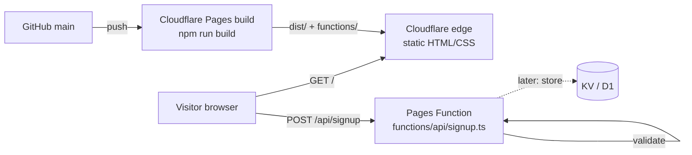
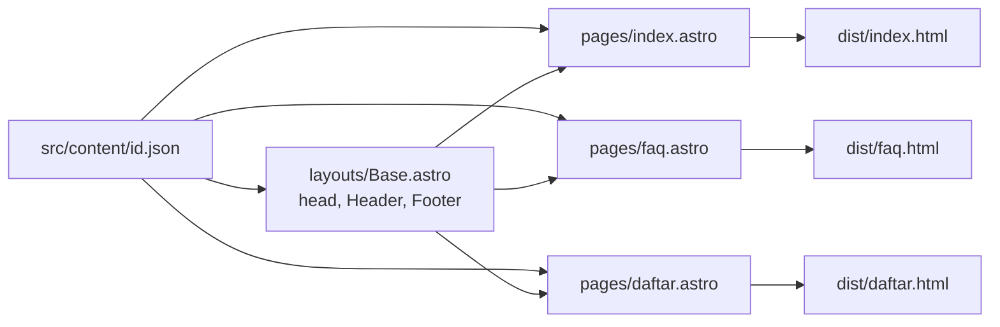
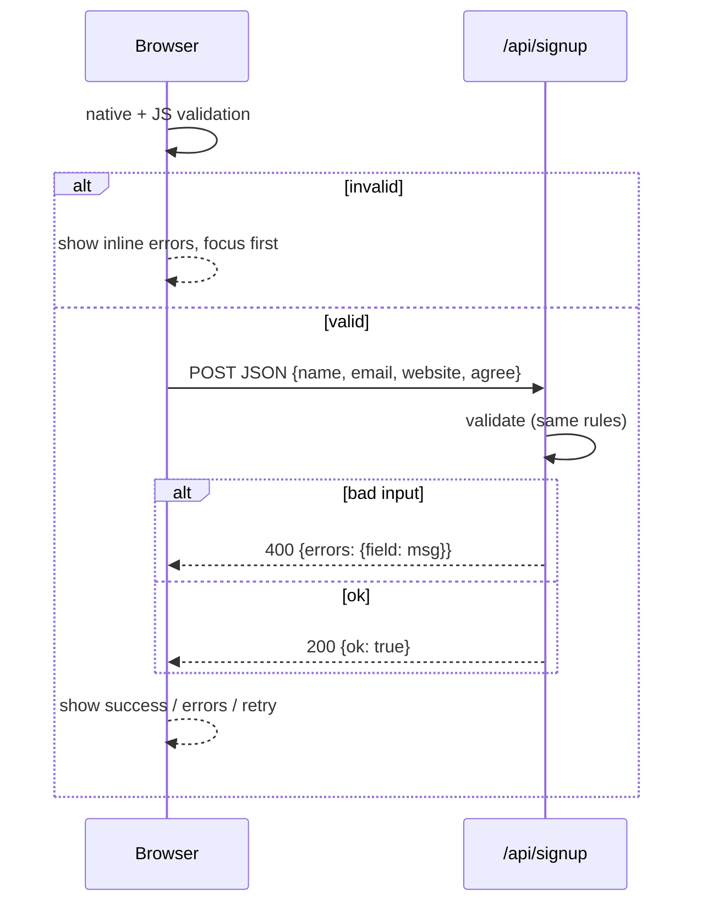

# Architecture

Static landing page + one serverless endpoint. Decisions in [adr/](adr/).

## System



- Page is pre-rendered at build time (Astro default static output). No server rendering.
- Only dynamic part: `POST /api/signup`, a Cloudflare Pages Function.

## Build-time data flow



Content is one JSON file passed down as props. Components hold layout only, no copy. A second locale = `en.json` + routes. Pages build as flat files (`faq.html`) so Cloudflare serves `/faq` without a redirect.

## Pages and component tree

```
layouts/Base.astro       <html lang>, meta, skip link, Header, Footer   (used by 3 pages)
├─ Header                nav: logo, 5 menus (<details> dropdowns), language, account; mobile hamburger
└─ Footer                breadcrumb, 6 columns (<details> on mobile), socials, payments, legal

pages/index.astro        landing, same section order as source
├─ Hero                  H1, line, CTA → /daftar
├─ Testimonials          3 cards; mobile scroll-snap + dot pager (tiny IntersectionObserver)
├─ Steps                 4 centered steps + CTA → /daftar
├─ Benefits              2 columns: list + SVG illustration
├─ Band (FAQ)            dark band, button → /faq
├─ Media                 outline button + video slot
├─ Terms                 2 columns: SVG illustration + text + button
└─ Band (final CTA)      dark band, button → /daftar

pages/faq.astro          Faq: <details> list
pages/daftar.astro       SignupForm: form + inline script (validation, fetch)
```

Section components exist because each is a content boundary (one JSON key in, markup out). Band is reused twice; Logo in header and footer.

## Signup flow



Validation rules live in one place, `src/lib/validate.ts`, imported by both the form script and the Function, so client and server can't drift.

## Directory layout

```
src/
  layouts/Base.astro
  pages/index.astro, faq.astro, daftar.astro
  components/*.astro
  content/id.json
  lib/validate.ts
  styles/global.css      Tailwind + design tokens
functions/api/signup.ts
tests/landing.spec.ts
docs/
```

## Non-functional choices

| Concern | How |
|---------|-----|
| Perf | Zero framework JS; one small inline script for the form; system font fallback; no images except SVG |
| A11y | Semantic landmarks, native `<details>`, labelled inputs, `aria-live` status, visible focus, `prefers-reduced-motion` |
| SEO | Static HTML, meta + OG from JSON |
| Security | Server-side validation, length caps, JSON-only body, no secrets |
