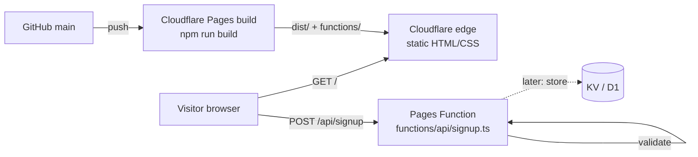
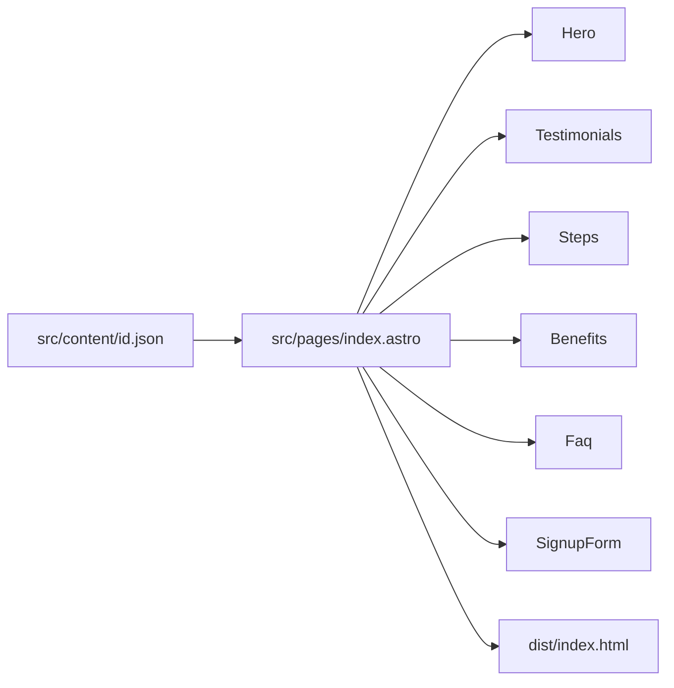
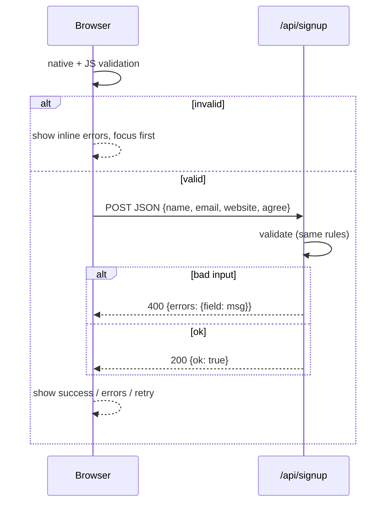

# Architecture

Static landing page + one serverless endpoint. Decisions in [adr/](adr/).

## System



- Page is pre-rendered at build time (Astro default static output). No server rendering.
- Only dynamic part: `POST /api/signup`, a Cloudflare Pages Function.

## Build-time data flow



Content is one JSON file imported by the page and passed down as props. Components hold layout only, no copy. A second locale = `en.json` + one route.

## Component tree

```
index.astro            layout shell: <html lang>, meta, header, main, footer
├─ Hero                h1, value prop, commission badge, CTA → #daftar
├─ Testimonials        scroll-snap row of cards
├─ Steps               4 numbered steps
├─ Benefits            3 items
├─ Faq                 <details> list
├─ SignupForm          form + inline <script> for validation + fetch
└─ (footer inline)     links, disclaimer
```

Components are added only when used more than once or when they hold real logic. Header/footer live inline in the page.

## Signup flow



Validation rules live in one place, `src/lib/validate.ts`, imported by both the form script and the Function, so client and server can't drift.

## Directory layout

```
src/
  pages/index.astro
  components/*.astro
  content/id.json
  lib/validate.ts
  styles/global.css      Tailwind + design tokens
functions/api/signup.ts
tests/landing.spec.ts
docs/
```

## Non-functional choices

| Concern | How |
|---------|-----|
| Perf | Zero framework JS; one small inline script for the form; system font fallback; no images except SVG |
| A11y | Semantic landmarks, native `<details>`, labelled inputs, `aria-live` status, visible focus, `prefers-reduced-motion` |
| SEO | Static HTML, meta + OG from JSON |
| Security | Server-side validation, length caps, JSON-only body, no secrets |
