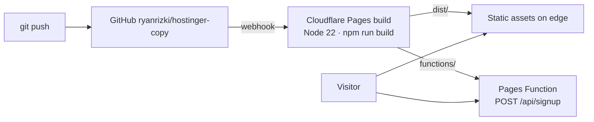

# Deployment (Cloudflare Pages)

Why Pages: [ADR 0004](adr/0004-cloudflare-pages.md).

## Architecture



## Config in the repo

| File | Purpose |
|------|---------|
| `wrangler.jsonc` | Project name, output dir `./dist`, compatibility date. Read by `wrangler pages dev` and `wrangler pages deploy` |
| `.node-version` | Node 22 for the Cloudflare build image (Astro needs ≥ 22.12) |
| `functions/api/signup.ts` | Becomes `POST /api/signup` automatically, no routing config |

No secrets or environment variables are needed in v1. When some are added: local values go in `.dev.vars` (git-ignored), production values via dashboard or `npx wrangler pages secret put NAME`.

## Option A: Git integration (recommended)

One-time setup, by the repo owner:

1. Cloudflare dashboard → **Workers & Pages** → **Create** → **Pages** → **Connect to Git**
2. Pick `ryanrizki/hostinger-copy`
3. Build settings:
   - Framework preset: **Astro**
   - Build command: `npm run build`
   - Build output directory: `dist`
   - Root directory: `/`
4. **Save and Deploy**

After that:

| Event | Result |
|-------|--------|
| Push to `main` | Production deploy at `https://<project>.pages.dev` |
| Push to any other branch / PR | Preview deploy at `https://<branch>.<project>.pages.dev` |

## Option B: Direct upload from a laptop

```bash
npx wrangler login
npm run build
npx wrangler pages deploy
```

`wrangler pages deploy` reads the output dir from `wrangler.jsonc` and uploads `functions/` with it. First run asks to create the project.

## Local run (same runtime as production)

```bash
npm install
npm run build
npm run preview          # wrangler pages dev → http://localhost:8788, API included
npm test                 # builds, starts wrangler, runs Playwright
```

`npm run dev` (Astro dev server) is fine for UI work but does **not** serve `/api/signup`.

## Custom domain (optional)

Pages project → **Custom domains** → add domain. If the domain's DNS is on Cloudflare, the record and SSL certificate are created automatically.

## Caching

- Hashed assets in `/_astro/*` are immutable; Pages caches them at the edge.
- HTML is revalidated on each deploy.
- `/api/signup` is a POST, never cached.

## Rollback

Pages project → **Deployments** → pick a previous production deploy → **⋯ → Rollback to this deployment**. Instant, no rebuild.

## Monitoring

- **Web Analytics**: enable in the Pages project (no cookies, no banner needed).
- **Function logs**: Pages project → Deployments → a deploy → **Functions** → real-time logs; or `npx wrangler pages deployment tail`.

## Cost

Free tier covers this: unlimited static requests, 100k Function requests/day, 500 builds/month.

## Troubleshooting

| Symptom | Fix |
|---------|-----|
| Build fails with Node engine error | Check `.node-version` is committed (needs ≥ 22.12) |
| `/api/signup` 404 on deployed site | `functions/` must be at repo root, not inside `src/` |
| `/api/signup` 404 locally | You ran `npm run dev`; use `npm run preview` |
| Form shows "Gagal mengirim" | Check Function logs; 413 = body > 10 KB, 5xx = runtime error |

## AI notes

- AI first proposed `wrangler pages dev dist` in scripts; moved the dir into `wrangler.jsonc` so one file is the source of truth.
- Wrangler warned about the missing compatibility date during tests; pinned it in config.
- Not yet verified against a live Cloudflare account: dashboard steps follow current Cloudflare docs but the first real deploy needs the owner's account.
